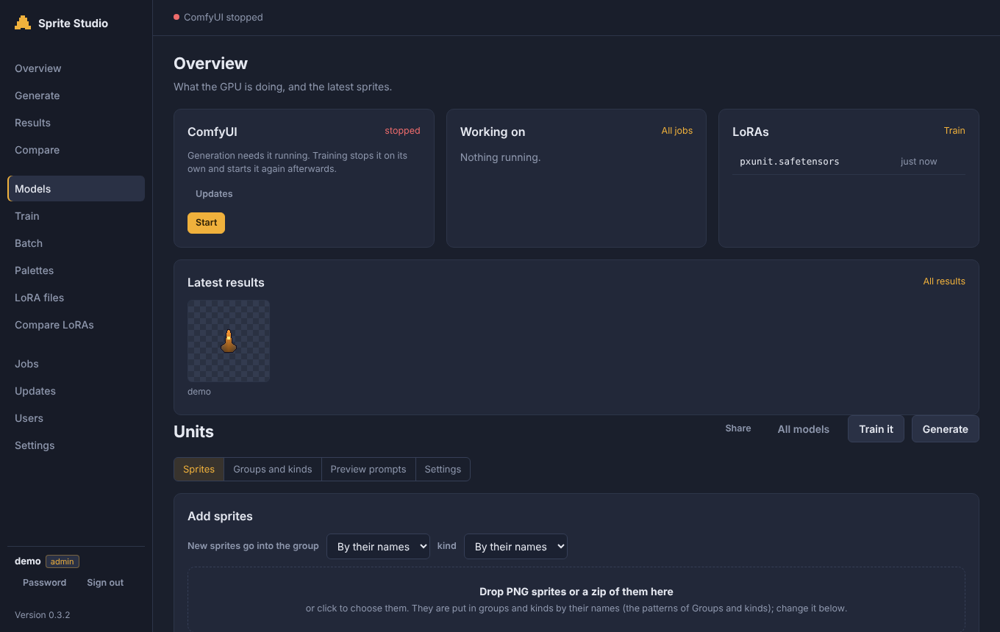
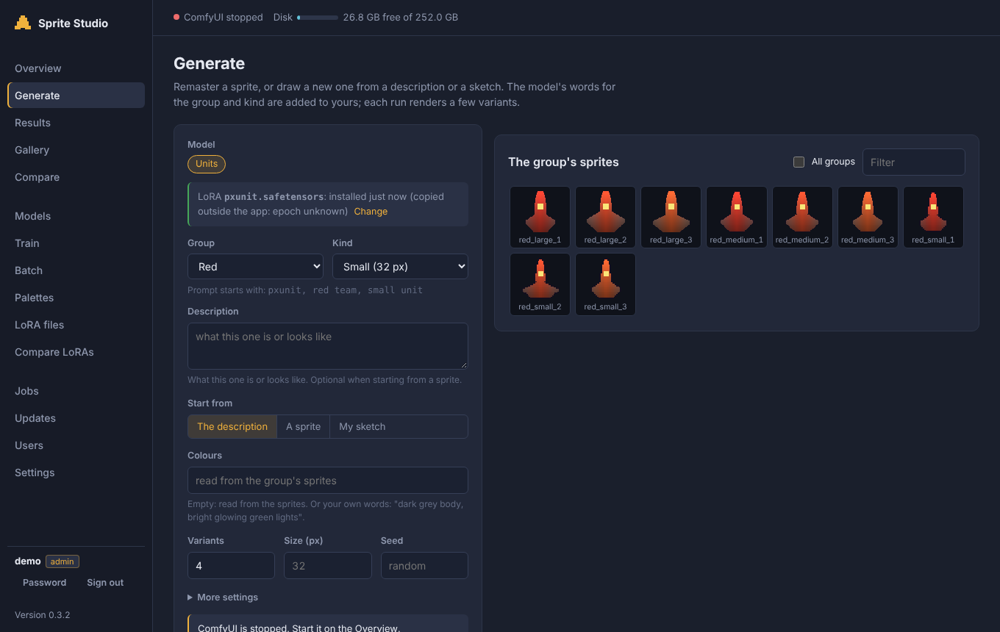
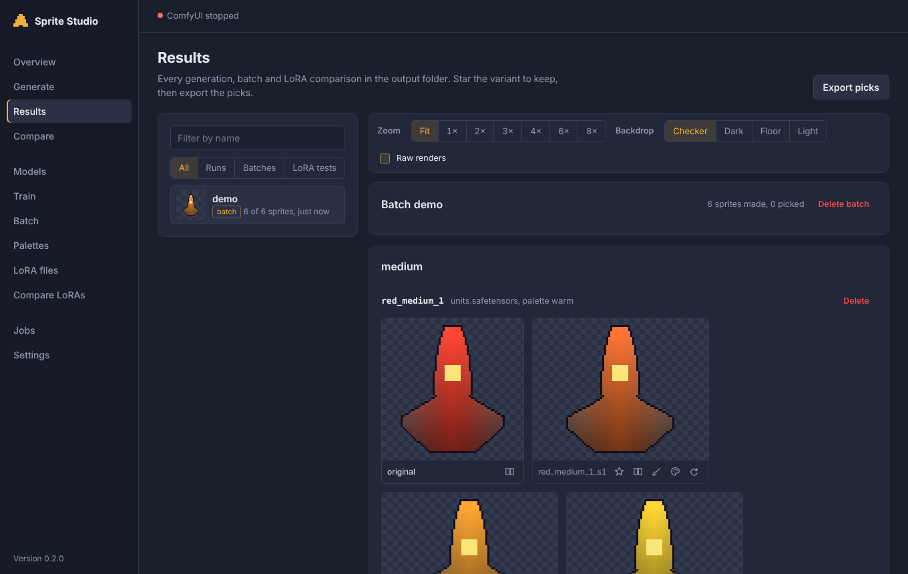
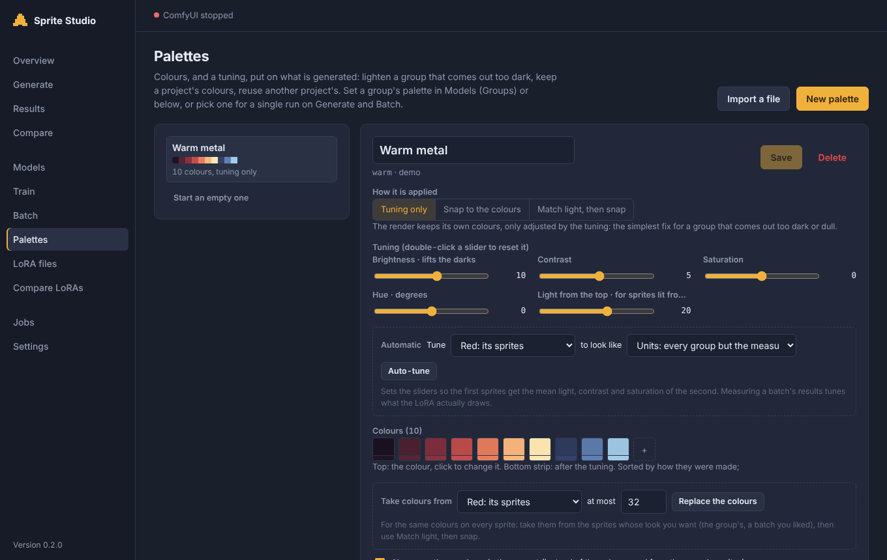

# Sprite Studio

Train a LoRA on your own pixel-art sprites, then generate new sprites in the
same style: remasters of existing ones, new designs from a description or a
sketch, whole batches. Everything runs on your machine, with
[ComfyUI](https://github.com/comfyanonymous/ComfyUI) for generation and
[kohya sd-scripts](https://github.com/kohya-ss/sd-scripts) for training, behind a
web app and a set of command-line tools.

## Features

- **Models**: one LoRA per model, organised in projects (one per game). A
  model has *groups* (teams, item families...) and *kinds* (size
  classes), each with the words that describe it; sprites are sorted into
  them by file name pattern or by hand. Template sets give ready-made
  starting points; models export and import as files.
- **Training**: training sets built from the model (captions, a whole-number
  pixel grid per kind, optional relighting of sprites lit from below), SD 1.5
  or SDXL, live progress and preview grids per epoch (rendered afterwards through
  ComfyUI when the card cannot do it while training), one click to install the
  epoch you prefer.
- **Generation**: remaster a sprite (same shape, new detail), invent one from
  a description or a sketch, touch up part of a sprite with a mask. Results
  are cleaned into real sprites: background removed, pixels read on the
  model's grid, colours limited to 64, outline, optional symmetry and fill.
- **Batches**: remaster every sprite of a model, or invent N new ones per
  group and kind, resumable, with comparison sheets.
- **LoRA files**: every installed LoRA in a table (model, epoch, date, size,
  results made with it); install, rename or delete them.
- **Palettes**: colours and a tuning (brightness, contrast, saturation, hue,
  light from the top) put on what is generated; taken from sprites or a batch,
  imported from `.hex` / `.gpl` / images, computed automatically to match
  other groups; exported for other tools.
- **Results**: browse, zoom, compare side by side, star the keepers and
  export them, recolour, clean up again from the raw render with live
  settings (colours, edge, outline, symmetry, palette), delete (with a bin
  and undo).
- **Gallery**: keep the sprites you like with the recipe that made them
  (LoRA, epoch, seed, prompt); they outlive their results and pin their LoRA,
  sort into folders and tags, share with other users, export as a zip.
- **Users**: everyone signs in; each user has their own models, results,
  palettes and jobs, can share them (read-only use) with chosen users or
  everyone, and administrators manage the accounts and see everything.
- **Any NVIDIA card**: PyTorch build, training precision and memory savers
  chosen from the card; time estimates measured on yours.

## Screenshots

The sprites below are simple shapes drawn by a script, and the results are
mock-ups: they show the interface, not what a trained model makes.

| | |
|---|---|
|  |  |
| **Models**: sprites sorted into groups and kinds | **Generate**: remaster, describe or sketch |
|  |  |
| **Results**: variants next to the original | **Palettes**: colours and tuning |

`python3 docs/screenshots/make_screenshots.py` rebuilds them.

## Requirements

- Linux (Debian 12/13 or Ubuntu 24.04+; Python 3.11 or newer), on a machine or in a container
  (an unprivileged Proxmox LXC container works).
- An NVIDIA GPU with 8 GB of memory or more, and its driver.
- About 35 GB of disk (50 GB with SDXL), 12 GB of RAM (16 recommended;
  32 for SDXL training).

## Quick start

```bash
git clone https://github.com/Psych0meter/sprite-studio.git
cd sprite-studio
sudo scripts/install.sh
```

Then open `http://<machine>:8189`, create the administrator with the setup code
printed in the service's log (`journalctl -u spritegen-web`), create a model in **Models**, add its
sprites, and train it on the **Train** page. The full walk-through, with GPU
passthrough for containers, is in [docs/INSTALL.md](docs/INSTALL.md); how
to get good sprites out of it is in [docs/GUIDE.md](docs/GUIDE.md).

To update an installation, pull and run `sudo scripts/install.sh` again: it
skips what is already done and copies the new version.

## Command line

The web app runs these scripts; they can be used on their own too (they are
in the `PATH` of the installation's user):

| Script | What it does |
|---|---|
| `pxmodel.py` | the models: sprites, captions, training sets, prompts, batch lists |
| `train_lora.sh` | `setup`, `dataset`, `train`, `install` a model's LoRA (`CATEGORY=<model>`) |
| `pxpreviews.sh` | the preview images a training run is missing, rendered through ComfyUI |
| `pxmake.sh` | one generation: prompt, ComfyUI render, clean-up into sprites |
| `pxbatch.sh` | every sprite of a model remastered, or new ones invented |
| `pxmatrix.sh` | a LoRA comparison: checkpoints x strengths on fixed seeds |
| `pxcomfy.py` | sends one job to ComfyUI's API |
| `pxtool.py` | image tools: clean-up, pixel grid, colours, palettes, sheets |
| `pxmesh.py` | a top-down sprite seen from a tilted camera (3/4 view), alone or as a training set |

Each script prints its options with `-h` (or at the top of the file).

## Project layout

```
scripts/        command-line tools (Python 3, Bash)
webapp/         the web app: app.py (FastAPI), accounts.py, auth_routes.py, users_cli.py, run.sh, static/ (HTML, CSS, app.js, accounts.js, palette.js)
docs/           installation, user guide, architecture
tests/          pytest suite (no GPU needed)
VERSION         the current version
CHANGELOG.md    what changed in each version
```

## Development

```bash
pip install -e ".[dev]"
ruff check . && ruff format --check .
shellcheck scripts/*.sh webapp/run.sh
for f in webapp/static/*.js; do node --check "$f"; done
pytest
```

The same checks run on every push (GitHub Actions). Conventions are in
[CLAUDE.md](CLAUDE.md); the design in [docs/ARCHITECTURE.md](docs/ARCHITECTURE.md).

Releases are published by GitHub Actions when a `vX.Y.Z` tag is pushed
(see the release rules in [CLAUDE.md](CLAUDE.md)).

## Licence

Sprite Studio is released under the [MIT licence](LICENSE).

It downloads Stable Diffusion 1.5 (and SDXL on request), released
under the CreativeML OpenRAIL-M licence and the CreativeML Open RAIL++-M
licence respectively. Check their terms before commercial use of what you
generate. ComfyUI (GPL-3.0) and kohya sd-scripts (Apache-2.0) are installed
from their own repositories.
